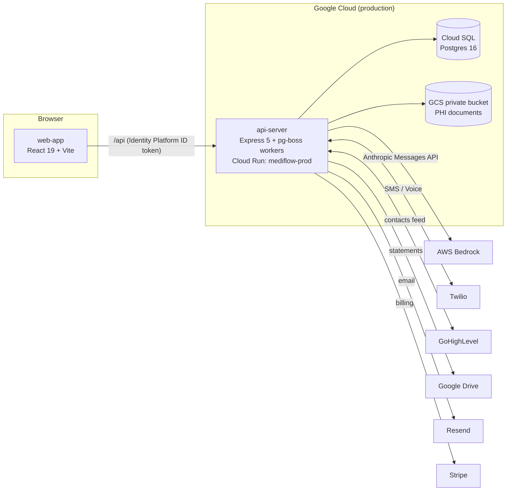

# agencyBRIDGE

**A multi-tenant operating system for Medicare insurance agencies** — CRM,
agent onboarding and licensing, compliance, commissions, a call queue and
softphone, and AI assistance — built to replace the patchwork of Monday.com,
GoHighLevel and spreadsheets that agencies run on today.

> **Naming.** The product is **agencyBRIDGE**. The repository, the GCP service
> (`mediflow-prod`), the deploy workflow and some HTTP headers still say
> **Mediflow** — an older name (rebrand: #216). They are the same thing.

| | |
| --- | --- |
| **Status** | Code-complete for a large feature set; CI and the Google Cloud deploy were green on `main` at `4911b43` (2026-10-04), but that is not yet proof of PHI readiness (see [Current state](#current-state)). **Not cleared for real PHI.** |
| **Last verified** | 2026-10-04, `main` @ `4911b43` |
| **Living status** | [`docs/STATE.md`](docs/STATE.md) — always newer than this file |
| **Working on this repo as an AI agent?** | Read [`AGENTS.md`](AGENTS.md) first |

---

## Current state

Honest snapshot as of **2026-10-04**. Anything here can go stale; the
authoritative, dated version lives in [`docs/STATE.md`](docs/STATE.md).

| Area | State |
| --- | --- |
| Application code | Feature-rich and tested: 86 API route modules, ~63 web pages, 69 database migrations, 164 API test files and 58 web test files. |
| `main` CI | **Green** at `4911b43` (typecheck, tests, migration journal, `pnpm audit`). It had been red on `pnpm audit` over advisory `GHSA-vfj7-8cjw-p6xm` (`braces`, no upstream patch) until the documented suppression landed in #272. |
| Production deploy | **Green** at `4911b43`: the Cloud Run deploy ran and the post-deploy Chromium check of the live page passed. It had failed on every push since 2026-10-02 (Secret Manager IAM gap). Passing a deploy does not by itself clear PHI — see next row. |
| PHI readiness | **Not cleared.** ADR 0004 (GCP production) is still "Proposed" and should be promoted by the owner now that a deploy has succeeded. Sign-in moves from Clerk to Google Cloud Identity Platform once its setup is done (see Auth row), several vendor BAAs are unconfirmed (see [Compliance](#compliance-and-phi)), and contact PHI reads are not audit-logged (see Known gaps). |
| Auth | **Google Cloud Identity Platform** (ADR 0006, accepted 2026-10-14): email + password and an authenticator app, MFA mandatory for everyone. Production keeps running the last Clerk build until the owner finishes [`docs/AUTH_IDENTITY_PLATFORM.md`](docs/AUTH_IDENTITY_PLATFORM.md). |
| AI | **Claude on AWS Bedrock** (Anthropic Messages API). Azure OpenAI is a supported alternate. Plain OpenAI is dev/test only. |
| Unmerged work | Open PRs change daily (list them on GitHub; do not trust a snapshot). At the 2026-10-04 snapshot the only branch with unlanded work was PR #272; the other ~155 had landed or add nothing, **but** two of them (`claudemoogs/practical-thompson-09n6cr`, `claudemoogs/dreamy-ptolemy-2ho4s0`) were reused for new open PRs #273 and #275 right afterwards and must not be deleted — see [`docs/BRANCH_AUDIT_2026-10-04.md`](docs/BRANCH_AUDIT_2026-10-04.md). |

### Known gaps (intentional, not bugs)

- **Not every PHI read is audited.** Contact list/detail responses decrypt Medicare ID, DOB and health conditions for privileged roles, but the contacts router runs with `includeReads: false`, so those disclosures write no audit row (only view-as-agency reads are logged). Treat this as a compliance gap to close before PHI launch.

- **E-signature is Beta.** The built-in provider has no KBA or sealed identity
  guarantees; production refuses it unless `ESIGN_PROVIDER=docusign` or
  `ESIGN_ALLOW_BETA_IN_PROD=true`.
- **Contracting paperwork is placeholder.** The Power of Attorney PDF is
  watermarked "DRAFT — NOT LAWYER-REVIEWED"; per-carrier templates are pending.
- **Client portal is a staff-facing preview.** Client logins are not built.
- **No Postgres row-level security.** Tenant isolation is enforced in
  application code and guarded by a static test (ADR 0002).
- **Dialer integration** (masterBRIDGE) has deferred phases; auto-dial for
  callbacks is not built.
- Some Reconciliation and Billing panels show "Coming soon".

---

## What it does

| Domain | Capabilities |
| --- | --- |
| **CRM & sales** | Contacts, leads, pipelines, two-way SMS, outbound email with delivery tracking (inbound email replies are not yet ingested), sequences, omnichannel campaigns, quoting, appointments, enrollment applications, retention and churn-risk scoring, AEP (annual enrollment) command center. |
| **Agents** | Onboarding checklists, state licenses, carrier certifications, AHIP records, e-signed contracting packets, "Ready to Sell" readiness board, leaderboard. |
| **Compliance** | Audit log (PHI writes, admin actions and view-as-agency activity; see Known gaps for unaudited reads), BAA checklist, complaint (CTM) tracker with SLA, marketing-material approval, call recording and AI-assisted call scoring, mandatory MFA, org-level session timeout. |
| **Commissions** | AgencyBloc-style commission tracking, carrier statement upload and **automatic intake from a watched Google Drive folder**, reconciliation, clawback exposure. |
| **Calls** | Inbound lead queue with routing and callbacks, Twilio Voice browser softphone, supervisor wallboard, masterBRIDGE dialer events. |
| **Platform** | Multi-agency workspaces, super-admin "view as agency" (view-only, audited), per-agency white-label branding, Stripe plans (Starter / Growth / Agency), import wizards (Monday.com, GoHighLevel, CSV), GoHighLevel contact sync. |
| **AI** | Context-aware chat drawer, SMS/email drafting, weekly compliance report, transcript analysis. |

Roles: `super_admin`, `agency_admin`, `compliance_manager`, `agent_support`,
`viewer`, `agent`, `developer`. The permission matrix is `artifacts/api-server/src/lib/permissions.ts`;
the navigation only *hides* links — the server is the real gate.

---

## Architecture



One container serves both the API and the built web bundle. Background work
(reminders, sweeps, retention, statement polling, GHL sync) runs in the same
process through **pg-boss**, a job queue stored in Postgres.

### Monorepo layout

```
artifacts/
  api-server/       Express 5 API + background workers (esbuild → dist/index.mjs)
  web-app/          React 19, Tailwind v4, shadcn/ui, wouter, TanStack Query
  mockup-sandbox/   Standalone UI sandbox (not part of production)
lib/
  db/               Drizzle ORM schema + SQL migrations (+ PHI encryption helpers)
  api-spec/         openapi.yaml — the API contract; Orval generates the two below
  api-client-react/ Generated React Query hooks
  api-zod/          Generated Zod schemas
  integrations-openai-ai-server/   AI client (bedrock | azure | openai)
  devtools/, object-storage-web/, integrations-openai-ai-react/
scripts/            Seed, deploy (GCP), client-move, smoke tests
docs/               Architecture, deploy guides, integration guides, ADRs
e2e/ journeys/ runner/ load-tests/   Opt-in browser, evidence-video and k6 tests
```

**Contract-first API.** Edit `lib/api-spec/openapi.yaml`, then run
`pnpm --filter @workspace/api-spec run codegen`. Never hand-edit the generated
clients, and keep `lib/api-zod/src/index.ts` as the single line
`export * from "./generated/api"`.

### Security model (summary)

- **Tenant isolation:** every org-scoped handler filters on the caller's
  `orgId`; a static guard test (`__tests__/guards/tenant-isolation.test.ts`)
  fails the build if a route forgets. No database-level backstop yet (ADR 0002).
- **PHI at rest:** Medicare ID and SSN are encrypted (`PHI_ENCRYPTION_KEY`) with
  an HMAC blind index (`PHI_HMAC_KEY`) for lookup. Roles without PHI privilege
  see masked values.
- **Boot guards** refuse to start in production with: a non-HIPAA AI provider,
  non-GCS storage, the Beta e-sign provider, an ephemeral signing cert, or demo
  mode paired with live credentials.
- **Auth:** Google Cloud Identity Platform (email + password, authenticator-app MFA), MFA required for all users (cannot be disabled in
  production), per-org inactivity timeout (default 30 min), rate limits on auth.
- **Auditing:** automatic audit-log rows for writes and admin actions; super-admin
  view-as-agency is read-only by default and always logged; the narrow audited
  exceptions are invitation create/resend/revoke and support edits of basic
  contact/agent profile fields (these need MFA, support-edit headers and a reason).

---

## Quick start

Requires **Node 24** and **pnpm 10.28** (`npm`/`yarn` are blocked on purpose).

### Fastest: demo with Docker (no accounts needed)

```bash
docker compose up --build        # → http://localhost:3000
```

Starts Postgres 16, runs migrations, seeds the "INSUREitALL Demo" agency and
runs in no-auth **demo mode**. Demo mode bypasses authentication, so the server **refuses to start** if `DEMO_MODE=true` is combined with `NODE_ENV=production` or production-looking credentials.

### Develop locally

The Vite dev server has **no `/api` proxy**, so `vite` on port 5173 cannot reach
the API by itself. Use the supported same-origin workflow: build the web app and
let the API serve it.

```bash
pnpm install --frozen-lockfile
pnpm --filter @workspace/db run migrate        # needs DATABASE_URL
pnpm seed:demo                                 # optional sample data

# Build the web bundle (the API serves artifacts/web-app/dist/public itself).
# Demo, no accounts:  VITE_DEMO_MODE=true  here AND  DEMO_MODE=true  on the API.
# Real auth: set VITE_FIREBASE_API_KEY / _AUTH_DOMAIN / _PROJECT_ID here and
# IDENTITY_PLATFORM_PROJECT_ID on the API (docs/AUTH_IDENTITY_PLATFORM.md).
VITE_DEMO_MODE=true pnpm --filter @workspace/web-app run build

# API (builds, then starts; no hot reload) → http://localhost:8080
DEMO_MODE=true PORT=8080 DATABASE_URL=postgres://… pnpm --filter @workspace/api-server run dev
```

`pnpm --filter @workspace/web-app run dev` (hot reload) is for UI-only work and
will not talk to a local API unless you add your own proxy.

There is no `.env.example`; variable names are listed per integration in
[`docs/DEPLOY_GCP_PRODUCTION.md`](docs/DEPLOY_GCP_PRODUCTION.md) and
[`docs/integration/`](docs/integration/). Outside production, PHI keys fall back
to a development sentinel.

### Verify (what CI runs)

```bash
pnpm run typecheck
pnpm test                       # vitest; integration tests use in-memory PGlite
node --test tests/*.test.mjs    # dependency-free quality smoke test
pnpm audit --audit-level moderate
```

Opt-in: `pnpm e2e` (needs Identity Platform config, a test login + running app), `pnpm evidence` (records
role-journey videos), `load-tests/` (k6), `pnpm --filter @workspace/scripts run smoke:bedrock`.

---

## Deployment

| Path | Role |
| --- | --- |
| **Google Cloud Run + Cloud SQL** (`.github/workflows/deploy-mediflow-gcp.yml`, `scripts/deploy/gcp-*.sh`) | **The production target.** Deploys on push to `main` using keyless Workload Identity Federation. Setup: [`docs/DEPLOY_GCP_PRODUCTION.md`](docs/DEPLOY_GCP_PRODUCTION.md). Currently failing — see [Current state](#current-state). |
| `docker-compose.yml`, root `Dockerfile` | Local / demo only. |
| Railway (`railway.json`) | **Demo instance, never PHI** (ADR 0003). Not auto-deployed. |
| Render (`render.yaml`, `render.prod.yaml`) | **Do not use for production** — no BAA (#261). `render-deploy.mjs` refuses to run. |

`GITHUB_REPO` for the identity setup is case-sensitive: `copperlang2007/Mediflow`.

---

## Compliance and PHI

agencyBRIDGE handles Medicare IDs, dates of birth, health conditions and call
recordings. **Do not load real client data into any environment other than a
confirmed production deploy.**

| Vendor | What it handles | Is a BAA needed? |
| --- | --- | --- |
| Google Cloud (Run, SQL, GCS, Speech-to-Text) | Hosts the database, stores documents and call recordings | **Yes** — it holds PHI. Repo claims coverage under Google's compliance program; confirm the BAA is signed and accepted. |
| AWS Bedrock | AI (Claude) | **Yes, as built** — chat and call analysis send live client data and transcripts to the model, and a boot guard requires a HIPAA-eligible AI provider. Repo claims the operator's AWS BAA; confirm. |
| Azure OpenAI | Alternate AI | Microsoft offers a BAA; not the active provider. |
| Render | — | **No BAA. Never use.** |
| OpenAI (direct API) | — | **No BAA.** Dev/test only; never PHI. |
| HighLevel, EnrollHere | Systems the agency already uses; the platform reads contacts/calls from them | **Not a platform decision.** Only needed to the extent they hold client health or Medicare data, and that is the agency's own relationship with them. |
| DocuSign | Signing agent contracting paperwork (not client records) | **Probably not** for agent paperwork. The code asks for a HIPAA-eligible plan if DocuSign is used; that guard may be stricter than necessary. Needed only if client documents are ever signed through it. |
| Twilio (voice + SMS) | Client calls through the browser softphone; texts; optional call recording (off by default) | **Likely yes for calls.** Live call audio passes through Twilio and a sales call will include health details; recording, if turned on, stores it there too. Texts can be kept PHI-free, calls cannot. Confirm Twilio's BAA covers the products used, or stop using Twilio for client calls. Decide with your compliance advisor. |
| Resend | Email to clients | **Depends on content.** Simplest safe design: keep Medicare IDs and health details out of email bodies. |
| Stripe | Agency subscription billing | **No** — no client health data. |
| Sentry | Error reports | **No, if PHI is kept out.** Events are regex-scrubbed for MBI/SSN/phone/email, which is defense in depth, not a substitute: it cannot see dates of birth, free-text diagnoses or recording content. |

These are statements found in code and docs, **not verified contracts, and not legal advice** — whether a vendor needs a BAA depends on whether PHI actually reaches it; confirm with a compliance advisor. The
in-app BAA checklist is `GET /admin/baa-checklist` / "Security & HIPAA".

---

## Decisions that shaped the repo

Architecture decision records live in [`docs/decisions/`](docs/decisions/).

| ADR | Decision | Status |
| --- | --- | --- |
| 0001 | Stripe billing; Starter / Growth ($297) / Agency ($997) tiers | Accepted |
| 0002 | Tenant isolation in app code with a static guard, not RLS (yet) | Accepted |
| 0003 | Railway `mediflow-prod` is a demo, not production | Accepted |
| 0004 | GCP Cloud Run + Cloud SQL is the production target | **Proposed** — promote after a real deploy |
| 0005 | Bedrock is called via the Anthropic Messages API | Accepted |
| 0006 (identity) | Move from Clerk to GCP Identity Platform | **Accepted** (2026-10-14) |
| 0006 (SOA) | Scope of Appointment is captured on the call recording | Accepted |

Two files share the number 0006; renumber one when next editing the ADRs.

---

## Repository health notes

- **Two migrations share number `0064`** (`call_recordings`, `statement_ingest`).
  The journal check passes; avoid creating more collisions — check the highest
  number on `main` immediately before generating a migration.
- **Stale root files** are catalogued in [`docs/STATE.md`](docs/STATE.md#stale-and-orphaned-files).
  `docs/ARCHITECTURE.md` still says production AI is Azure OpenAI; Bedrock is correct.
- **~150 stale remote branches** exist; see the audit above.

## Contributing

Branch from `main`, keep PRs small, and make `typecheck`, `test` and `audit`
green. Dependabot minor/patch PRs auto-merge after CI. Agents: follow
[`AGENTS.md`](AGENTS.md), including the mandatory end-of-session state note.
